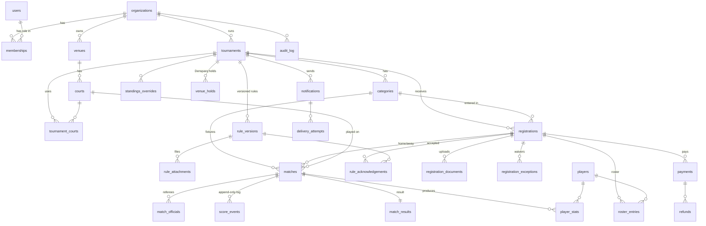

# Data model

The full DDL is in [`schema.sql`](./schema.sql). Types mirror [`src/domain/types.ts`](../src/domain/types.ts).

## Design notes

| Decision | Why |
|---|---|
| `tournaments.scoring` (JSON) is separate from `rule_versions.sections` (HTML) | Requirement 3.2: written rules and machine-readable logic are separate. The engine only reads `scoring`. |
| `rule_versions` are immutable once published; partial unique indexes allow one `published` and one `draft` per tournament | Version history and per-version acknowledgement (acceptance criteria #2 and #3). |
| `rule_acknowledgements` stores the exact `rule_version_id` and time | "Store the accepted rules version and time" (3.2). |
| `score_events` is append-only with `client_id` unique | Offline referee devices retry safely; corrections never destroy history (3.5). |
| `match_results.verified_by <> submitted_by` | Four-eyes verification. Only `verified` results feed standings and stats (3.6, 3.7). |
| Gist exclusion `no_court_overlap` | The database itself refuses double-booking a court (3.4). |
| `players` is separate from `users` and optionally linked | Minors and guests can be entered by a captain; their profile follows them to the academy module (3.7). |
| `venue_holds` share shape with the operator dashboard's Holds | Fixtures at Densparq write event holds, which produce "Block on Playo" tasks. |
| Standings are computed, not stored | One source of truth. Materialise only if reads get slow. |
| Money is integer paise; actual vs projected are separate queries | "Distinguish actual revenue from projected fees" (3.8). |
