# Screens, states and API calls

Every screen handles four states the same way:
- **Loading**: skeleton.
- **Empty**: icon, one sentence and the primary action.
- **Error**: message plus "Try again".
- **No access** (403): which role is needed.

Every mutation shows a toast. On an API error, the error's `message` appears as a red toast. Validation errors (`422` with `details.field`) are shown inline next to the field, and focus moves to the first invalid field.

Routes use the hash router (`#/…`), so the preview works as a static file. Switch to `createBrowserRouter` in production.

## Core workflow (doc §6)

```mermaid
flowchart LR
  A[Create draft<br/>wizard 1-7] --> B[Scoring config<br/>step 4] --> C[Rules draft → publish v1] --> D[Publish tournament<br/>checklist]
  D --> E[Registration opens<br/>ack vN + pay] --> F[Confirm entries<br/>waitlist / refunds] --> G[Generate fixtures<br/>fix clashes] --> H[Publish fixtures<br/>notify + venue holds]
  H --> I[Live scoring<br/>referee pad] --> J[Submit → verify] --> K[Standings + bracket advance] --> L[Results, stats, reports] --> M[Archive]
```

## Organizer console (`#/o/:org/...`)

### Organization screens

| Screen | Route | Reads | Actions → API |
|---|---|---|---|
| Tournaments | `/o/:org` | `GET /orgs/:org/tournaments` | New → `/new` · Duplicate → `POST /tournaments/:id/duplicate` (opens setup) · Archive (confirm) → `POST …/archive` |
| Venues & courts | `/o/:org/venues` | `GET /orgs/:org/venues` | read-only (court admin is part of the venue dashboard) |
| Staff & roles | `/o/:org/staff` | `GET /orgs/:org/members` | Invite → `POST /orgs/:org/members` · Remove (confirm) → `DELETE /memberships/:id` |
| Rule templates | `/o/:org/templates` | `GET /orgs/:org/templates` | Preview |
| Audit log | `/o/:org/audit` | `GET /orgs/:org/audit` | — |

### Create/edit wizard (`/o/:org/new`, `/o/:org/t/:tid/setup?step=1..8`)

- Without an id, step 1's "Create draft & continue" calls `POST /orgs/:org/tournaments`, then routes to `?step=2`.
- Every later step change calls `PUT /tournaments/:id` with the whole form (autosave).
- Validation: one zod schema per step (`STEP_SCHEMAS`). Going forward is blocked until the step is valid; going back is free.
- A step that was visited and is invalid shows a red "!".
- The wizard is organizer-only; other roles get a 403 state.

| Step | Fields | Rules shown in UI |
|---|---|---|
| 1 Basics | name, sport, start/end date, description, contact | Changing sport resets scoring defaults |
| 2 Categories | name, entry type, gender, capacity, fee ₹, skill, min/max age, roster min/max (team) | Capacity ≥ 2; max age ≥ min age |
| 3 Format | per category: format card, groups, qualifiers, legs, seeding, third place | Live estimate of match count; custom format means manual results |
| 4 Scoring & standings | auto vs manual, points W/D/L/WO, tie-breakers (ordered), sport parameters, Lagori actions editor | Banner: machine-readable ≠ written rules |
| 5 Registration | opens/closes/roster cutoff, required docs, guardian age, waitlist, late entries, duplicate check, refund policy | Must close on or before the first day |
| 6 Courts & schedule | venue, courts (sport-fit hint), match length, buffer, rest, daily window, Densparq holds toggle | Explains the academy hold and Playo tasks |
| 7 Prizes & staff | prizes list, staff (referee / registration manager) | — |
| 8 Review & publish | `GET …/checklist`, category summary | Publish (disabled until all items pass) → `POST …/publish` · Unpublish |

### Inside a tournament

| Screen | Route | Reads | Actions → API |
|---|---|---|---|
| Overview | `/o/:org/t/:tid` | `GET …/dashboard` (every 15 s), `GET …/journey` | **Journey tracker** at the top: 7 stages, "Next" with one action (the Finish dialog → `POST …/finish`, then Archive). "Needs you now" links to each issue. Live-now card. Category fill. |
| Rules | `…/rules` | `GET …/rules` | New draft → `POST …/rules` · Copy from tournament/template → `POST …/rules {fromTournamentId\|templateId}` · Edit (Tiptap per section) → `PATCH /rule-versions/:id` · Upload PDF/Word → `POST …/attachments` · Publish (material/minor + summary) → `POST …/publish` · Unpublish · Views: Edit / Player preview / Compare vN−1 |
| Registrations | `…/registrations?status&categoryId&q` | `GET …/registrations` | Filters live in the URL. Row opens a drawer (`GET /registrations/:id`). Confirm / Offer place / Reject* / Withdraw* → `POST …/status`. Waive fee* → `POST …/exceptions`. Refund* → `POST …/refunds`. Doc approve/reject → `PATCH …/documents/:docId`. Export CSV. Add entry opens the public form. (*reason required) |
| Fixtures | `…/fixtures` | `GET …/matches`, `…/clashes`, `…/availability`, `…/venue-holds` | Generate/Regenerate (confirm) → `POST …/fixtures/generate`. Calendar: drag a match to a court/time cell → `PATCH /matches/:id` (toast shows any new clash). Edit dialog: court, start, referee, postpone + reason. Publish (blocked by hard clashes; notify toggle; holds notice) → `POST …/fixtures/publish`. Fill knockout → `POST …/fixtures/advance`. Views: Calendar · List · Bracket · Venue holds |
| Matches | `…/matches` | `GET …/matches?published=true` (every 10 s) | Tabs: Live / To verify / Upcoming / Verified. Open → review. |
| Match review | `…/matches/:mid` | `GET /matches/:mid`, audit | Verify → `POST …/verify` · Correct* → `POST …/correct` · Dispute* → `POST …/dispute` · Enter result manually → `POST …/submit {manual}` · Walkover* / Abandon* → `POST …/status` · Score log (voided events struck through) · Edit history |
| Standings | `…/standings` | `GET …/standings` | Group/league tables (lime bar = qualifying, "Provisional" chip). Override* → `POST …/standings/overrides`. Approve/Reject → `POST /standings-overrides/:id/decide`. Bracket. |
| Player stats | `…/stats` | `GET …/stats?key` | Players / Teams. Stat filter. Add manually* → `POST …/stats`. Export. |
| Reports | `…/reports` | `GET …/reports`, `…/dashboard` | Actual vs projected vs refunded. Funnel. Match progress and delay. By category. Court use. CSV: entries, results. PDF: browser print. |
| Messages | `…/messages` | `GET …/notifications` | New announcement (audience, title ≤ 60, body ≤ 500) → `POST …/notifications`. Delivery stats per send. |
| Settings | `…/settings` | tournament, members | Staff list, privacy statement |

## Referee scoring (`#/score`, `#/score/:mid`): phone-first, dark

| State | UI | API |
|---|---|---|
| My matches | Cards for assigned matches, ordered by time | `GET /me/matches` |
| Scheduled | "Start match" (disabled until both entries are known) | `POST /matches/:id/status {live}` |
| Live | Sport pad, Undo, Pause/Resume, Finish | Each tap is queued and flushed with `POST /matches/:id/events {events:[…]}` |
| Offline | Header shows "Offline · N saved on phone". Taps keep working; the score updates optimistically. | Flushes on reconnect |
| Finish (rules say finished) | Summary dialog, then Submit | `POST /matches/:id/submit` |
| Finish (not finished) | "End early?" plus a reason | `POST …/submit {force, reason}` |
| Submitted | Shows the result and "waiting for verification" | — |
| Manual-entry tournament | Start, then Finish asks for scores | `POST …/submit {manual}` |

**Pads**:
- **Rally**: two big tap zones; shows the current game score and games won.
- **Football**: clock, period buttons, goal/card dialogs (minute auto-filled, optional player), penalty shoot-out mode.
- **Cricket**: toss, runs 0/1/2/3/4/6, extras toggles, wicket, end innings, required rate.
- **Frisbee**: points, timeouts per half, cap, spirit dialog.
- **Lagori**: round timer, start/end round, configured action buttons per team, action log.

## Public (`#/t/:slug`, no login)

| Screen | Reads | Actions |
|---|---|---|
| Tournament page | `GET /public/t/:slug`, `GET /public/t/:slug/matches` (every 8 s) | Tabs: Overview (categories with places left, fees, prizes, contact) · Fixtures · Live & results (unverified results flagged) · Standings · Stats (minors hidden) · Rules (version + files). "Register now" shows only while the window is open. |
| Register | `GET /public/t/:slug` | **Steps**: Category → Players (+ guardian block under 18, inline validation, then `POST …/registrations/validate`) → Documents (if required, max 5 MB) → Rules (scroll to the end before the accept box is enabled) → `POST …/registrations {ackVersion}` → Pay (UPI/card/netbanking) → `POST /registrations/:id/payments`. **Outcomes**: a full category becomes "Join waitlist" (no payment); a free entry confirms immediately; a failed payment shows a toast and the entry stays `pending_payment` with a pay-later link. |
| Entry status | `GET /public/registrations/:id` | Status hero (confirmed / pending / waitlist # / rejected reason / withdrawn). Pay now. **Re-accept rules** after a material change → `POST /registrations/:id/ack`. Receipt number. |

## Edge cases covered

These are the doc §7 items to validate.

- **Ties**:
  - group tables use the ordered tie-breakers, with head-to-head among the tied entries only
  - knockout draws are rejected (penalties or a tie-break is needed)
  - cricket ties are allowed in groups
- **Forfeits**:
  - walkover with a reason; standings use the separate walkover points
  - byes are auto-walkovers
- **Late registrations**: blocked after close unless `allowLate` is on or an organizer adds the entry.
- **Court conflicts**:
  - prevented by the scheduler
  - flagged on manual moves
  - publishing is blocked
  - the DB has an exclusion constraint
  - Densparq bookings and holds count as busy
- **Changes after acknowledgement**:
  - a material change forces re-acceptance, tracked per entry
  - minor changes don't
  - the old version stays readable in history

---

# Venue management screens (`#/o/:org/...`)

| Screen | Route | Reads | Actions → API |
|---|---|---|---|
| Bookings calendar | `calendar?v&d&view=week` | `GET /venues/:id/calendar` (every 20 s) | Click an empty slot to open New booking. Click a booking to open its detail. Block courts → `POST /venues/:id/blocks` (`409 has_bookings` lists the bookings in the way). |
| New booking (drawer) | — | `POST /venues/:id/quote` (debounced live preview) | Customer search or new customer. Sport, source, date, start, duration, courts (several = group), weekly repeat until, offer code, use membership, manager override with reason, paid now. Submit → `POST /venues/:id/bookings`; the toast shows booked and skipped counts. |
| Booking detail (drawer) | — | `GET /bookings/:id` | Collect payment / Mark played / No-show → `POST …/status`. Reschedule → `PATCH`. Cancel (policy shown; managers can change the refund) → `POST …/cancel`. History. |
| Customers | `customers?tab&segment&q` | `GET /orgs/:org/customers` | Segment filter, search, export, add. The drawer shows consent toggles (audited), stats, membership, agreed rate, notes, feedback and bookings. Tabs: Follow-ups (Find people → generate, Done), Feedback (Resolve needs a resolution), Campaign (managers; shows sent and skipped-without-consent counts). |
| Memberships | `memberships` | `GET …/memberships`, `…/plans` | Status counts. Members table → drawer (ledger, renew, adjust, cancel, fixed slots). Renewals due in 14 days → Renew. Plans (owner edits). Enrol. |
| Pricing & offers | `pricing?v` | `GET /orgs/:org/pricing` | Rates as a calendar of day type × hour (click a cell to edit the rule, guardrails, reason). Offers (builder, pause, stacking note). Agreed rates. Price suggestions → Apply (`PUT /rate-rules/:id`). Change history. |
| Analytics | `analytics?v` | `GET /orgs/:org/analytics` | Venue and range filters (7/30/90/custom). Alerts deep-link. 8 KPI tiles vs previous. Revenue by day. Heatmap → drill-down modal (`GET …/analytics/bookings`) with CSV. Breakdowns by sport, court, band and source (sport and source drill down). Lead time. Customers. Memberships. Offers. Export CSV. |
| Venue setup | `venues?v` | `GET /orgs/:org/venue-setup` | Branch tabs. Profile (description, amenities, photos), hours and slots, buffer, refund policy, holidays → `PUT /venues/:id/profile`. Courts → `POST …/courts`, `PATCH /courts/:id`. Add branch (owner). |

**Branch scope**: a branch manager or front desk sees only their branches. Front desk has no Pricing or Analytics navigation, and the server enforces the same rules (`x-roles`).

---

# Landing and journeys

| Screen | Route | Reads | Actions |
|---|---|---|---|
| Home | `#/` | `GET /public/home` | **Public door**: Book a court (`/book`), Book a free academy trial (`/trial`, shows open seats), Join a tournament (open ones first). **Staff door**: workspace cards filtered by role (Venue, Academy, Tournaments). A guardian sees "My child's progress". The demo persona switcher sits top right. |
| Book a court | `#/book` | `GET /public/venues/:id/slots` | Sport, then one of the next 7 days, then a free slot (price shown), then name, mobile and WhatsApp opt-in → `POST /public/venues/:id/bookings` → Pay → `POST /public/bookings/:id/pay`. If the slot is taken meanwhile, a `409` refreshes the slots. |
| Trial enquiry | `#/trial` | `GET /public/home` | Sport and age show the batches that fit, with seats. Submit → `POST /public/academies/:id/trial`, which lands in Admissions as `new`. |
| Parent / athlete | `#/me` | `GET /me/athletes`, `/athletes/:id`, `/athletes/:id/stats` | Attendance, fees (Pay → `POST /invoices/:id/payments`), academy messages, progress charts and records (read-only). |
| Workspace switcher | sidebar | — | Venue · Academy · Tournaments, filtered by role. The brand link goes back to Home. |

# Academy screens (`#/o/:org/academy/...`)

| Screen | Route | Reads | Actions → API |
|---|---|---|---|
| Overview & reports | `academy` | `GET …/academy/overview` | Range 30/90/custom. Alerts deep-link. KPIs. Trial funnel. Most improved. Per-batch table. Export CSV. |
| Batches | `academy/batches?id` | `GET /academies/:id/batches`, `/batches/:id?date` | Cards with seats and attendance. **Drawer, Attendance tab**: date picker (training days only), All present, per-athlete P/L/A/E → `PUT …/attendance`; the toast names guardians alerted. **Drawer, Sessions tab**: −14..+28 days; Change → cancel or reschedule + reason. New/Edit batch: schedule rows, clash banner on `409`. |
| Athletes | `academy/athletes?q&status&batchId` | `GET /orgs/:org/athletes` | Filters, export, add (guardian and consent for under-18s; age-band warning). **Drawer**: stats link, enrol, transfer (+reason), end or pause (+reason), stats-visibility setting, fees, attendance strip, family messages, change history. |
| Player stats | `academy/player-stats?athlete` | `GET /athletes/:id/stats` | Per-metric trend charts (filled = measured, hollow = estimated), change chips, cohort position with its rule, assessment table (~ = estimated), matches (manual + tournament). Record assessment (template-driven; measured toggle). Add match. **Tabs**: Batch rankings (rule shown; needs 5+), Metrics & methods (versioned editor). |
| Fees & payments | `academy/payments?status` | `GET /orgs/:org/fees` | Outstanding and overdue tiles. Status filter. Record payment, discount/scholarship (+reason), refund (+reason). Create month's invoices (idempotent). Send reminders. Fee plans. Export. |
| Admissions | `academy/admissions` | `GET /orgs/:org/leads` | Funnel tiles. **Pipeline** columns by stage; card → drawer: allowed moves only (lost needs a reason; trial needs a batch and a training day), Enrol (creates athlete + invoice). **Conversion report**: by source, lost reasons. |
